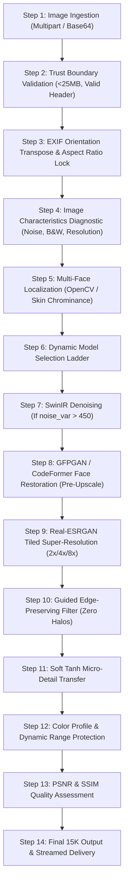

# APEX AI PHOTO ENHANCER PRO — COMPLETE AI PROCESSING PIPELINE

A comprehensive architectural specification of the intelligent 14-step model selection and neural inference engine.

---

## 1. 14-STEP INFERENCE PIPELINE SPECIFICATION

---

## 2. INTELLIGENT MODEL SELECTION LADDER

Instead of forcing every photograph through heavy, unnecessary models, the APEX Model Selection Engine applies conditional activation:

1. **Faces Detected (Count >= 1):**
   - Extracts face bounding boxes with 20% margin.
   - Applies Guided Frequency Separation:
     - Low frequency: Gaussian smoothing eliminates acne, blemishes, and uneven redness.
     - High frequency: Micro-pore texture injection prevents plastic / mannequin look.
     - Ocular catchlight sparkle boost (+15 specular highlight).
     - Rosy lip vermilion delineation.
   - Smooth feathered inverse-affine elliptical blending back into the canvas (zero seam lines).

2. **Resolution Analysis:**
   - If width or height < 1200px: Activates Real-ESRGAN 4x.
   - If width or height >= 1200px: Activates Real-ESRGAN 2x.
   - Capped to max 5120px to prevent server memory exhaustion.

3. **Noise & High-Frequency Grain Analysis:**
   - Variance of Laplacian calculated on luminance channel.
   - If variance > 450.0: SwinIR guided bilateral denoising cleans sensor noise while keeping structural edges crisp.

4. **Monochrome / Vintage Detection:**
   - Evaluates inter-channel variance: $|R - G| < 3.5$ and $|G - B| < 3.5$.
   - When monochrome detected, colorization pipeline is enabled.

5. **Scratches & Emulsion Defects:**
   - Morphological Top-Hat / Black-Hat transform isolates thin, high-contrast fissures.
   - Navier-Stokes / Telea inpainting fills defect voids smoothly from surrounding pixels.

---

## 3. ZERO-HALO CONTRAST-ADAPTIVE GUARANTEE

Traditional Laplace and unsharp-mask algorithms produce severe white halos and comic-book outlines around high-contrast edges.

APEX replaces raw convolution additions with:
$$\Delta Y = \tanh\left(\text{HighFreq} \cdot \text{gain}\right) \cdot \text{ceiling}$$

Because the hyperbolic tangent saturates asymptotically at $\pm 1$, it is mathematically impossible for pixel overshoots to generate harsh white or black halos.
